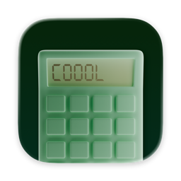
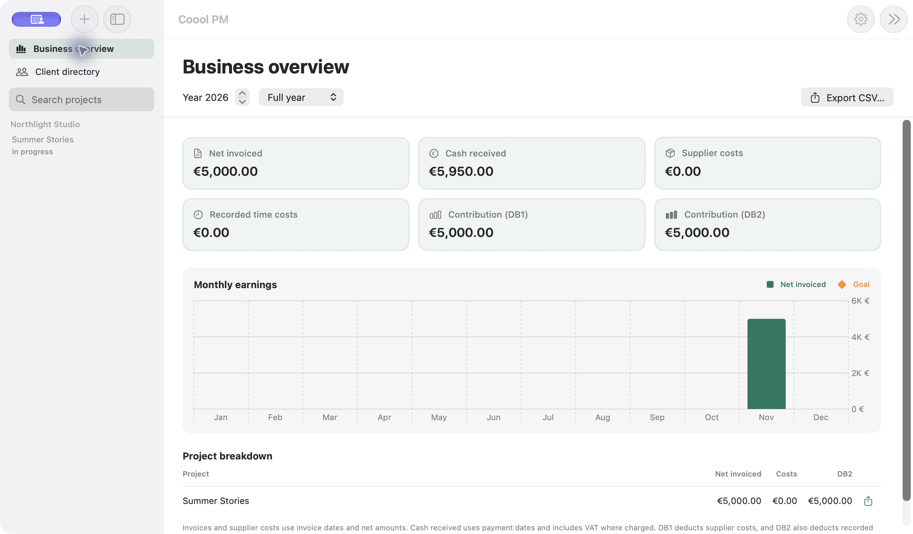
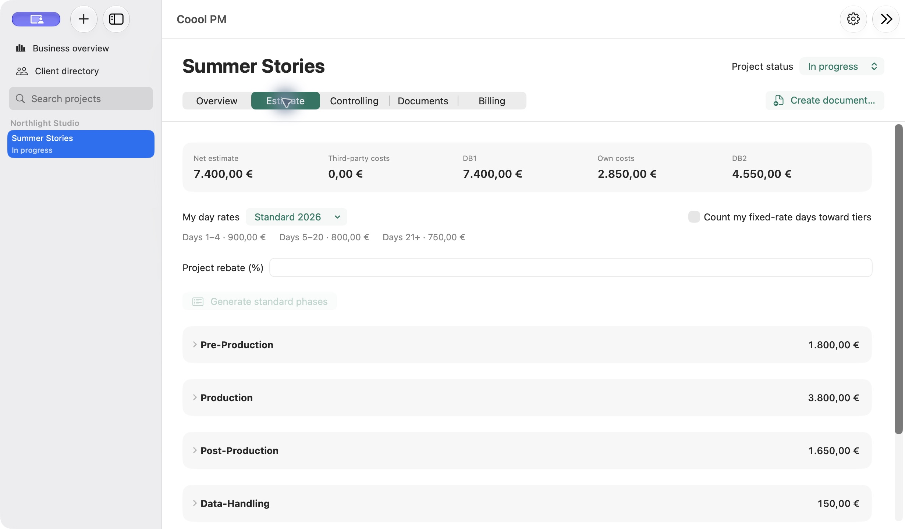

<p align="center">
  
</p>

<h1 align="center">Coool PM</h1>

<p align="center"><strong>From your first estimate to the final invoice.</strong></p>
<p align="center">A native Mac workspace for the business side of creative work.</p>

<p align="center">
  <a href="#get-started">Get started</a> ·
  <a href="#what-you-can-do">Features</a> ·
  <a href="#a-little-help-from-local-ai">Local AI</a> ·
  <a href="#your-work-your-data">Privacy</a> ·
  <a href="#find-your-way-around">Guides</a>
</p>

---

Creative projects come with people, plans, changing scopes—and plenty of paperwork. Coool PM brings those pieces together in one library on your Mac, so you can follow a project from the first enquiry through the final payment.

Built for **freelancers, creative producers and project managers**. Start with a simple setup, then enable more detailed planning and financial tools when you need them.



*Screenshots use fictional demonstration records.*

## What you can do

Create projects, clients, and freelancers from the macOS File menu. Use View to switch workspaces, or duplicate a project to reuse its calculation and phase text for a new client.

**Project workflow** — Use Controlling for costs and margin, Documents for proposals and supplier invoices, and Billing for client invoices and payments. The document editor shows key fields and flags missing information. Settings includes a resizable template preview, multiline rich-text business details, and a project autosave switch. Open the demo library with a skippable guided tour during setup or from Settings. Update-enabled builds check at launch by default.

| Your next task | How Coool PM helps |
| --- | --- |
| **Work out a price** | Plan phases, people and equipment. Use your own progressive day rates, fixed rates, crew prices and project rebates. |
| **Send a proposal** | Create German or English proposals, export PDFs or editable Word documents, and keep track of versions and approval. |
| **Manage the production** | Organize clients, contacts, freelancers and project folders. Track supplier costs, internal time and changes in scope. |
| **Invoice and get paid** | Plan split billing, create partial invoices, add purchase order references and record payments. |
| **See how business is going** | Review monthly earnings, costs and profit, set goals and export financial summaries as CSV. |
| **Make it your own** | Choose a usage profile, hide unnecessary features, personalize documents and switch between English and German. |



**Keep it simple—or go deeper.** Solo creatives can use a lighter interface. Producers and project managers can add team planning, forecasts and contribution margins: DB1 after external costs, and DB2 after internal costs.

## Get started

Download the [Apple Silicon tester installer](https://github.com/clonegitroot/coool-pm-macos/releases/tag/v1.0.2) for macOS 14 or later, or build from source below. The tester installer is ad-hoc signed and unnotarized. See the [installation guide](docs/INSTALL.md) for opening it on macOS. Local AI requires Apple Silicon.

### Let Claude or Codex help

Prefer a guided build? Open the checkout in your coding assistant and use the **[ready-to-copy build prompt](docs/BUILD_WITH_AI.md)**. It explains the build steps, checks and how to keep existing data safe.

### Build from the terminal

You need **a Mac with full Xcode installed and its command-line tools selected**. Open Xcode once to finish its setup, then open a terminal in this repository.

On Apple Silicon, install Xcode’s Metal compiler component if it is missing:

```sh
xcodebuild -downloadComponent MetalToolchain
```

Build and open the app:

```sh
./build.sh
open "Coool PM.app"
```

The first build downloads the declared dependencies. AI model weights are downloaded separately, only when you choose to use local AI. Intel builds omit the local inference helper.

**Once it opens:** choose **Explore demo library** to look around with sample projects. For your own workspace, save your recovery key, choose a language and usage profile, add your business details and create your first client.

[Full build instructions and troubleshooting →](docs/DEVELOPMENT.md)

## A little help from local AI

Turn a brief into a starting point: draft proposal text, suggest project phases and roles, or review a calculation for possible gaps.

- Runs on your **Apple Silicon Mac** after an optional model download.
- Recommends a model for your available hardware, with memory guidance and limitations.
- Can use **older projects you select** as references, including matching saved rates.
- Lets you edit roles, pricing methods, quantities and prices before applying changes.
- Can apply an unfinished draft so you can fill in missing prices later.
- Loads on demand and can unload after a task or a period of inactivity.

Local AI starts **off**. Suggestions need your review; the app’s calculation engine handles financial totals. An optional **MCP connection** lets an external AI client work with the app under separate permissions. Starting with 0.4.1, responses use anonymous project/client aliases and omit real names, numbers and custom phase/entry labels; older 0.4.0 builds do not include this filter. [ChatGPT connection guide](docs/CHATGPT_MCP.md).

[AI usage and example prompts](docs/AI_GUIDE.md) · [KI-Anleitung auf Deutsch](docs/AI_GUIDE_DE.md)

## Your work, your data

**Your library stays on your Mac by default.** Project and directory records, sensitive business settings and new backups are encrypted. Setup creates a recovery key for you to save or print.

- **Back up the workspace:** projects, saved attachments, settings, document templates and more are included in encrypted archives.
- **Choose what connects:** local AI, MCP and cloud services are optional. MCP clients may share returned data with their provider, depending on their configuration.
- **Keep ordinary files editable:** original imports, installed Word templates and exported documents remain normal files. Document conversion and previews can create temporary copies.
- **Keep the key safe:** Coool PM has no recovery service that can replace a lost key.

An iCloud Drive folder can hold encrypted backups. Automatic private CloudKit sync requires a separately provisioned build; it is not configured by the standard local build.

[Read the storage, backup and recovery details →](docs/PRIVACY.md)

## Find your way around

The app includes **searchable offline help in English and German**. Open **Help → Coool PM Help**, or press **⌘?**. The help and repository user guides share the same source content.

| Looking for… | Start here |
| --- | --- |
| Everyday workflows | [English user guide](docs/USER_GUIDE.md) · [Deutsches Handbuch](docs/USER_GUIDE_DE.md) |
| Better AI drafts and reviews | [Prompting guide](docs/AI_GUIDE.md) · [KI-Briefings auf Deutsch](docs/AI_GUIDE_DE.md) |
| Help building with an AI assistant | [Claude / Codex build prompt](docs/BUILD_WITH_AI.md) |
| Encryption, backups or recovery | [Privacy and recovery guide](docs/PRIVACY.md) |
| Building, checks, MCP or CloudKit setup | [Development guide](docs/DEVELOPMENT.md) |

<details>
<summary><strong>A few useful things to know</strong></summary>

- **Documents stay editable.** DOCX exports open in Word or Pages. Template-based PDF rendering requires Pages.
- **Extra billing tools are optional.** XRechnung validation requires a local Java runtime, KoSIT validator and matching rules.
- **Local builds and distribution are different.** The standard build is signed locally. Distribution and notarization require additional signing setup.
- **The demo is disposable.** Its records are fictional; demo edits disappear when you close it.
- **Feedback is welcome.** Use the Issues tab for bugs or ideas. Include reproduction steps and fictional examples; keep client records, financial details and recovery keys out of reports.

</details>

## License

Coool PM is source-available. You can use it for your own paid client work and share eligible forks for free under the [Coool PM license](LICENSE). Selling or bundling it commercially, offering paid hosted access, and use by large organizations require a written agreement as described in the license. [Third-party notices](THIRD_PARTY_NOTICES.md).
